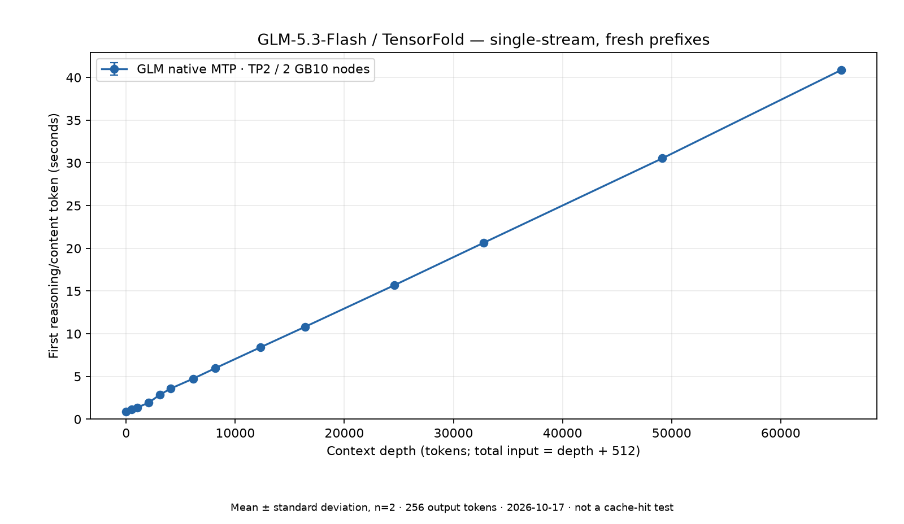
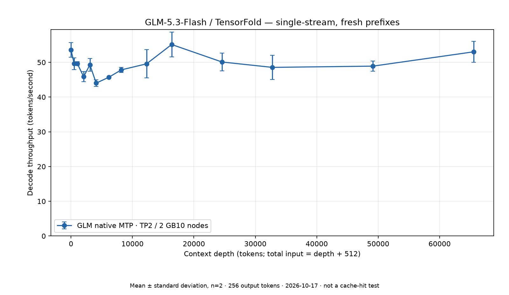

# 2× DGX Spark — GLM-5.3-Flash / TensorFold benchmarks

**Standard GLM-5.3-Flash EXL3 weights with native MTP**, served by Jay's TensorFold fork across
**two NVIDIA GB10 / DGX Spark nodes (TP2)**. No modified/abliterated checkpoint or DFlash2 drafter.

## Two separate studies

- **Original single-stream sweep:** [historical comparison](comparison.md), 14 points, 28 measured requests.
- **Later c1/c2/c4 matrix:** [concurrency report](concurrency.md), all 42 points and 196 measured requests.
  **Mixed-load, not isolated scaling:** 46 additional/unattributed completions occurred during that run.
  Global cache counters cannot be assigned to the benchmark alone. The c1 baseline was rerun within the matrix.

## Original single-stream result

Measured **2026-10-17** on the already-running service, without restart, cache flush or tuning.
The same 14-point depth grid and llama-benchy parameters as the
[Qwen3.5](https://github.com/fankserver/dgx-spark-qwen3.5-122b-bench) and
[Laguna](https://github.com/fankserver/dgx-spark-laguna-s21-nvfp4-bench) studies were used.

**Result:** first-token latency rises from **0.89 s at depth 0 to 40.86 s at depth 65,536**;
mean single-stream decode is **44–55 tokens/s** across the grid. All 28 measured requests produced
exactly 256 tokens. This run reused **zero cached tokens**: the client selects random book prefixes.
It measures fresh-prefix speed, **not conversation-cache effectiveness**.




## Environment

| Item | Recorded configuration |
|---|---|
| Model | `Mia-AiLab/GLM-5.3-Flash-EXL3-4bpw-TensorFold`, revision `078455ffe6472f9a52fbc1139f58b9db2881b25c` |
| Quantization | Standard EXL3 expert weights, q4mse dense, FP8 latent KV |
| Engine | TensorFold `2f8e514b0b7d615df7c971627ce3c0fb7e55d93a`, Jay recipe `f79bf9c72968f79bc8f1dc788ddb48ac974d2858` plus pinned local contract patch |
| Hardware | Two NVIDIA GB10 / DGX Spark-class UMA nodes, TP2, 200G fabric |
| Drafting | Native checkpoint MTP; deployed adaptive policy unchanged |
| Serving lanes | Four enabled; original study c1, later mixed-load matrix c1/c2/c4 |
| Context | 1048576 per-request declaration; shared pool, page-rounded1048832 tokens—not four full1M caches |
| Session store | 2GiB per rank; disk session tier disabled; prepared-weight cache separate |
| Client | llama-benchy0.4.0; actual installed module hashes recorded |
| Original benchmark | `--pp 512 --tg 256 --exact-tg --runs 2 --latency-mode generation --concurrency 1` |
| Concurrent follow-up | `--concurrency 1 2 4`, same other parameters; extra work was present |
| Depths | `0 512 1024 2048 3072 4096 6144 8192 12288 16384 24576 32768 49152 65536` |

Exact image ID, source pins, tokenizer/corpus hashes and validation scope are in
[`results/methodology.json`](results/methodology.json). Current deployment procedures live in the
[lab serving guide](https://github.com/fankserver/dgx-spark-lab/tree/main/docs/serving), not this frozen result repo.

## Contents

- [`comparison.md`](comparison.md): all 14 points, historical Qwen/Laguna checkpoints and limitations.
- [`dataset.csv`](dataset.csv) / [`dataset.json`](dataset.json): original single-stream results.
- [`dataset-concurrency.csv`](dataset-concurrency.csv) / [`dataset-concurrency.json`](dataset-concurrency.json):
  later observed matrix, per-stream and batch-window rates, TTFT spread and interference labels.
- [`results/`](results/): original report, allowlisted methodology and verified historical reference reports.
- [`graphs/`](graphs/): plots generated from the raw GLM report; error bars are standard deviation, not confidence intervals.
- [`scripts/`](scripts/): client-only reproduction, aggregation/plotting and offline tests.
- [`SHA256SUMS`](SHA256SUMS): frozen reports, datasets and plots.

## Reproduce

**You need an already-running authorized service.** A run consumes inference capacity and changes
cache contents naturally. The runner does not deploy, restart, clear caches, change clocks or download model weights.
It does not certify available memory or service safety. Choose an appropriate quiet window yourself.

```bash
python3 -m venv .venv
.venv/bin/pip install -r requirements.txt
.venv/bin/python scripts/run_benchmark.py \
  --base-url "$SPARK_BASE_URL" \
  --tokenizer "$GLM_TOKENIZER_PATH" \
  --api-key-file "$SPARK_API_KEY_FILE" \
  --output results/local-runs/new-run.json

# Offline: regenerate published datasets/plots, without running inference.
.venv/bin/python scripts/aggregate_and_plot.py
.venv/bin/python scripts/analyze_concurrency.py
.venv/bin/python -m unittest discover -s scripts -p 'test_*.py' -v
sha256sum -c SHA256SUMS
```

For a separate concurrency sweep, add `--concurrency 1 2 4` and choose a new output file.
That requests the same 14 depths at each level: 42 grid points and 196 measured requests, plus
warmups/probes. The default remains concurrency 1; the original published dataset is unchanged.

The endpoint should include `/v1`; tokenizer points to the exact checkpoint's tokenizer directory
or `tokenizer.json`. Credentials stay in a private file or `OPENAI_API_KEY`, never this repository.
The reproduction script is a portable example, not the original host controller. Version0.4.0
alone does not establish byte-identical client source: compare recorded module hashes if required.

## Interpretation and limits

- Context depth **plus 512** is the actual input size. Warmups/probes are not among the 28 measured requests.
- TTFT counts the first **reasoning or content** token, not necessarily the visible final answer.
- Complete token IDs were unavailable; client counts use server usage and interpolated stream timing.
- The client flag `prefix_caching_enabled=false` describes special context-load test mode, not the server.
  **Server caching stayed enabled**. Original sweep reuse was zero; later global cache counters include
  additional traffic and cannot establish the matrix's own hit rate. Neither is a conversation-cache test.
- There are two measured batches per point: two requests in the original study, and 2/4/8 requests
  at c1/c2/c4 in the matrix. Samples are small; sampling/speculative acceptance depends on generated text.
- Same test points do not mean equal models, quantization, hardware count or software. Historical
  Qwen/Laguna references use one node; this GLM configuration uses two. No per-GPU/cost/quality ranking follows.
- The concurrent follow-up completed, but extra work prevents an isolated scaling conclusion.
  Neither study is a conversation-cache diagnosis, full1M test, soak or cold-host-boot qualification.
- Sampled memory minimum 7.33 GiB head / 10.42 GiB worker, swap 0: **not an 8 GiB-floor safety pass**.

Original execution evidence is linked from the methodology record. Private host configuration,
credentials and raw generated snippets are intentionally excluded. No model weights are distributed;
model, engine and dependency licences remain separate.
