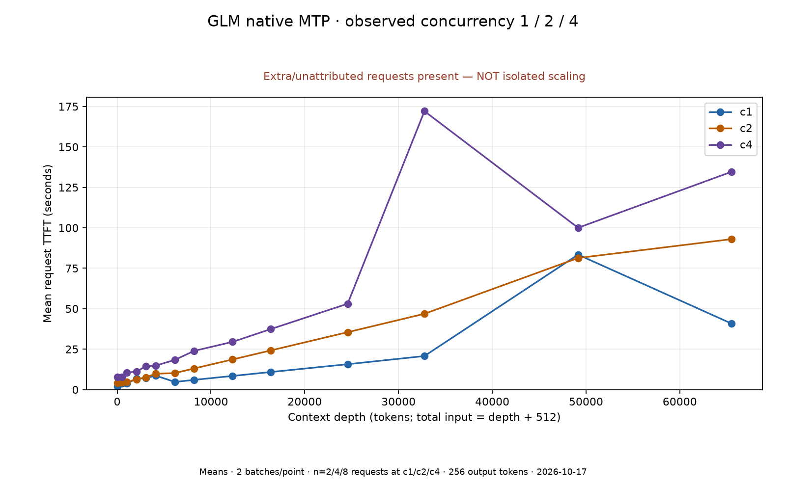
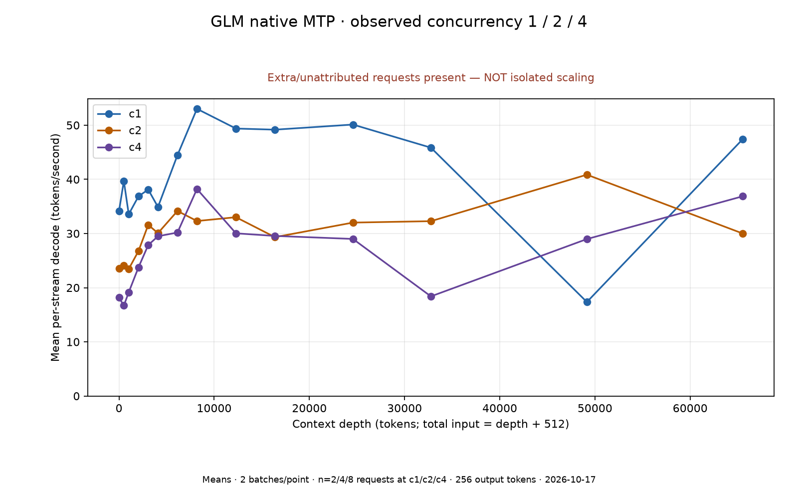
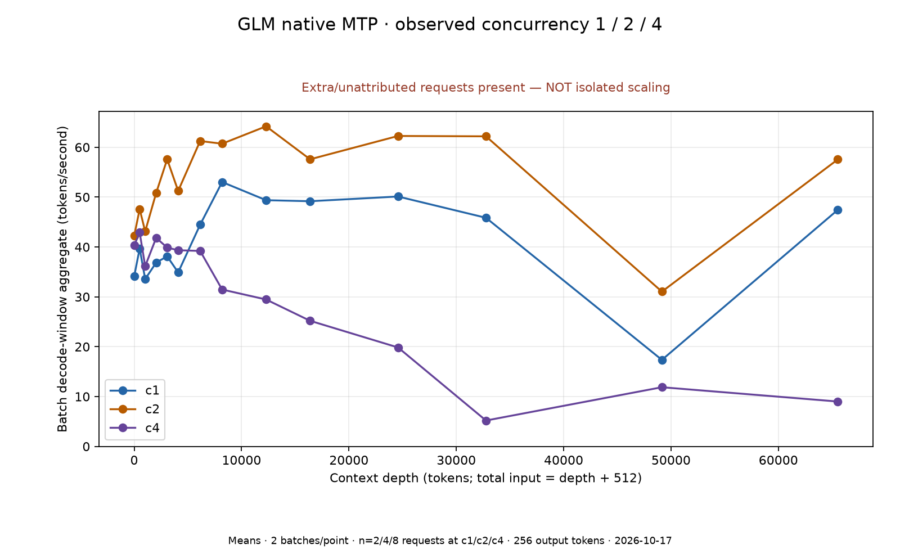

# Observed concurrency 1 / 2 / 4

**Completed matrix, NOT a clean concurrency-scaling comparison.**
The client accounts for 300 requests including warmups/probes; native completions increased 346.
There were **46 additional/unattributed completions**, and 63 samples with more than four in flight.
The source of additional work is not identified. Do not attribute every delay or rate solely to concurrency.

Same 14 depths, pp512/tg256/exactTG, two measured batches at each level:42 grid points and196 requests.
Each input was depth+512 and every measured output exactly256. Service/container unchanged; no restart,
tuning or cache flush. This is a new c1 baseline in the same sweep, not the earlier c1 study reused.

Means below use2/4/8 individual requests at c1/c2/c4 respectively. Only two batches per point.

## Mean request TTFT (seconds)

First reasoning or content token, not necessarily visible final-answer text.

| Context depth | c1 | c2 | c4 |
|---:|---:|---:|---:|
| 0 | 2.03 | 4.00 | 7.90 |
| 512 | 3.76 | 4.35 | 7.84 |
| 1,024 | 3.77 | 4.58 | 10.49 |
| 2,048 | 6.73 | 6.40 | 11.16 |
| 3,072 | 7.08 | 7.60 | 14.46 |
| 4,096 | 8.70 | 9.79 | 14.82 |
| 6,144 | 4.73 | 10.22 | 18.36 |
| 8,192 | 6.00 | 13.04 | 23.91 |
| 12,288 | 8.44 | 18.61 | 29.47 |
| 16,384 | 10.87 | 24.21 | 37.41 |
| 24,576 | 15.69 | 35.48 | 53.06 |
| 32,768 | 20.74 | 46.86 | 172.11 |
| 49,152 | 83.41 | 81.34 | 100.02 |
| 65,536 | 40.78 | 93.03 | 134.67 |

## Mean per-stream decode (tokens/second)

| Context depth | c1 | c2 | c4 |
|---:|---:|---:|---:|
| 0 | 34.11 | 23.55 | 18.17 |
| 512 | 39.70 | 24.11 | 16.70 |
| 1,024 | 33.56 | 23.46 | 19.15 |
| 2,048 | 36.87 | 26.76 | 23.75 |
| 3,072 | 38.12 | 31.59 | 27.87 |
| 4,096 | 34.90 | 30.08 | 29.50 |
| 6,144 | 44.47 | 34.16 | 30.18 |
| 8,192 | 53.02 | 32.31 | 38.22 |
| 12,288 | 49.38 | 33.01 | 30.04 |
| 16,384 | 49.18 | 29.33 | 29.56 |
| 24,576 | 50.12 | 32.02 | 29.00 |
| 32,768 | 45.85 | 32.28 | 18.39 |
| 49,152 | 17.36 | 40.86 | 28.98 |
| 65,536 | 47.45 | 30.00 | 36.88 |

## Batch decode-window aggregate (tokens/second)

| Context depth | c1 | c2 | c4 |
|---:|---:|---:|---:|
| 0 | 34.11 | 42.23 | 40.33 |
| 512 | 39.70 | 47.59 | 42.89 |
| 1,024 | 33.56 | 43.12 | 36.14 |
| 2,048 | 36.87 | 50.84 | 41.84 |
| 3,072 | 38.12 | 57.58 | 39.87 |
| 4,096 | 34.90 | 51.25 | 39.35 |
| 6,144 | 44.47 | 61.25 | 39.20 |
| 8,192 | 53.02 | 60.71 | 31.46 |
| 12,288 | 49.38 | 64.20 | 29.47 |
| 16,384 | 49.18 | 57.59 | 25.19 |
| 24,576 | 50.12 | 62.27 | 19.84 |
| 32,768 | 45.85 | 62.19 | 5.19 |
| 49,152 | 17.36 | 31.04 | 11.87 |
| 65,536 | 47.45 | 57.56 | 9.00 |

## Interpretation

- Per-stream rate excludes its own prefill but includes pauses while other work runs. Aggregate spans
  the batch's first token to its last token;
  staggered prefill/admission can fall inside that window. It is not concurrency times mean per-stream TPS.
- Do not infer a clean speedup/efficiency curve or a tuning recommendation from this mixed-load run.
- Global cache deltas include extra traffic; the benchmark's own cache reuse cannot be assigned.
- Client/tokenizer/corpus-file hashes match the first study, but reported corpus-token count differs
  (141280 versus143040). Download-versus-cache text loading can normalize line endings. All levels here
  use one loaded corpus; random input strings are not identical across runs.
- Four native decoding lanes were observed. That does not prove every point had four simultaneously decoding.
- Sampled available memory minimum6.56GiB head/10.92GiB worker, swap0; not an8GiB-floor safety pass.
- No per-turn cache diagnosis, quality test, long-context/soak or cold-host-boot qualification.

[Raw report](results/glm53-standard-mtp-c1-c2-c4.json) · [Methodology](results/concurrency-methodology.json) ·
[CSV](dataset-concurrency.csv) · [JSON](dataset-concurrency.json). Original single-stream reports remain unchanged.
